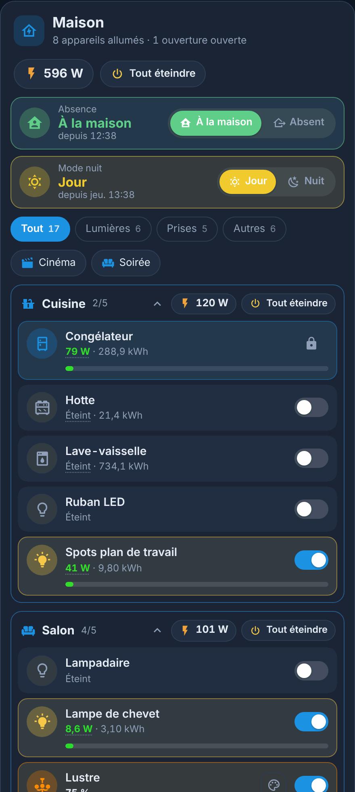
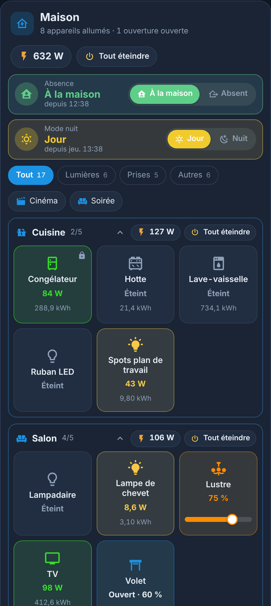
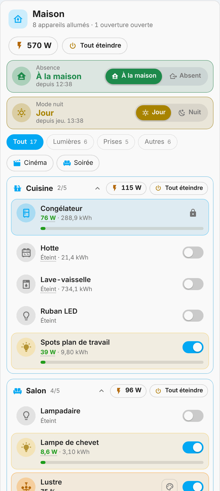
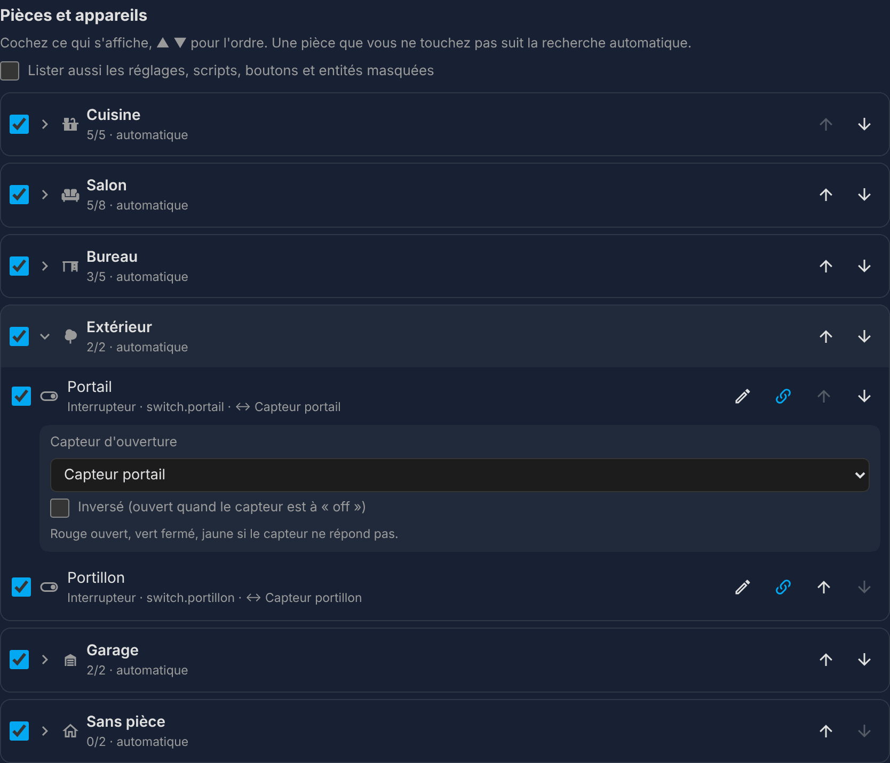
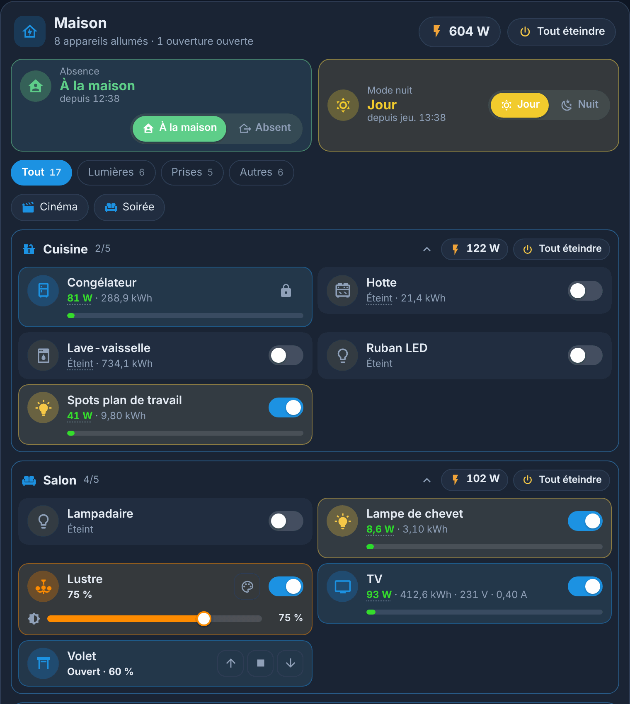

# Carte Commandes

[](https://hacs.xyz/)
[](https://github.com/XdLog/commandes-card/releases)

**Tout ce qui se commande dans la maison, rangé par pièce, dans une seule carte Lovelace** : lampes, prises, interrupteurs, ventilateurs, volets, portail et porte de garage, modes de la maison (présence, nuit…).

Fusion de [Carte Prises](https://github.com/Marlboro62/prises-card) et [Carte Lumières](https://github.com/Marlboro62/lumieres-card) de [Marlboro62](https://github.com/Marlboro62), dont elle reprend le style et la mesure de consommation.

| Liste | Boutons | Thème clair |
| --- | --- | --- |
|  |  |  |

**[▶ Essayer la démo en ligne](https://xdlog.github.io/commandes-card/docs/demo.html)** : une maison fictive, avec l'éditeur, sans Home Assistant.

## Sommaire

- [Ce que fait la carte](#ce-que-fait-la-carte)
- [Installation](#installation)
- [Régler la carte dans l'éditeur](#régler-la-carte-dans-léditeur)
- [Gestes](#gestes)
- [Comment la carte trouve les appareils](#comment-la-carte-trouve-les-appareils)
- [Référence YAML](#référence-yaml)
- [Historique des versions](#historique-des-versions)

## Ce que fait la carte

**Commander**
- Lampes : marche / arrêt, luminosité, blanc chaud ↔ froid, couleurs.
- Prises et interrupteurs, avec un **second appui pour valider** (pas de congélateur coupé par erreur) ; appareils **verrouillés** sans aucune commande.
- Ventilateurs (vitesse), volets (monter, arrêter, descendre, position), scripts, boutons et scènes.
- **« Tout éteindre »** pour la carte et pour chaque pièce, validé d'un second appui ; les appareils verrouillés ne sont jamais coupés.
- Curseurs à glissement : un appui ou un défilement ne dérègle rien.

**Mesurer**
- Puissance, énergie (du jour si elle existe), tension et courant des appareils qui les mesurent, barre de charge du vert au rouge.
- Puissance totale de la carte et de chaque pièce, sans compter deux fois un capteur commun.

**Ouvertures**
- Un capteur d'ouverture associé à une commande (portail, porte de garage…) la colore : **rouge ouvert, vert fermé, jaune si le capteur ne répond pas**.

**Modes de la maison**
- Présence, absence, vacances, nuit… dans un bandeau sous l'en-tête : état en clair, depuis quand, sélecteur à deux positions.

**Organiser**
- Pièces dans l'ordre de votre choix, pièces masquées, appareils cochés et ordonnés dans chaque pièce, tuiles renommées : tout dans l'éditeur visuel.
- Affichage en liste ou en boutons, filtre Lumières / Prises / Autres, thèmes bleu nuit, clair ou Home Assistant. Aucune dépendance.

## Installation

**Avec HACS** : **HACS › ⋮ › Dépôts personnalisés**, adresse `https://github.com/XdLog/commandes-card`, type **Tableau de bord**. Téléchargez **Carte Commandes**, puis rechargez la page (Ctrl+F5).

**À la main** : copiez `commandes-card.js` dans `config/www/`, puis **Paramètres › Tableaux de bord › ⋮ › Ressources** : `/local/commandes-card.js`, type **Module JavaScript**.

Ajoutez ensuite la carte **Commandes** au tableau de bord, ou en YAML :

```yaml
type: custom:commandes-card
```

Sans autre réglage, la carte trouve seule vos lampes, prises et interrupteurs et les range par pièce.

## Régler la carte dans l'éditeur



L'éditeur visuel a trois parties : les **réglages généraux** (titre, affichage, thème…), les **modes de la maison** et les **pièces et appareils**.

### Pièces et appareils

- **Pièces** : la case affiche ou masque la pièce ; ▲ ▼ changent son rang.
- **Appareils** : une pièce dépliée liste toutes ses commandes. Cochées, elles s'affichent ; ▲ ▼ règlent leur ordre. La case « Lister aussi les réglages, scripts, boutons… » montre aussi ce que la carte écarte d'habitude.
- Une pièce que vous ne touchez pas reste en **automatique** : un nouvel appareil y apparaît tout seul. Une pièce **personnalisée** n'affiche que ce qui est coché. « Revenir à l'automatique » annule vos choix pour une pièce ou pour toutes.

Sur chaque commande :

| Icône | Réglage |
| --- | --- |
| ✏️ | **Nom et icône** de la tuile. Vide : nom de Home Assistant, sans le nom de la pièce ni le type d'appareil. La pièce peut rester en automatique. |
| 🔗 | **Capteur d'ouverture** : celui du même appareil et de la même pièce en premier ; « Aucun » ; « Inversé » pour un capteur à « off » quand c'est ouvert. |

### Ouvertures

| Capteur | Couleur | Texte | Commande |
| --- | --- | --- | --- |
| ouvert | rouge | Ouvert | « Fermer », puis « Fermer ? » |
| fermé | vert | Fermé | « Ouvrir », puis « Ouvrir ? » |
| indisponible, inconnu | jaune | État inconnu | « Actionner », puis « Actionner ? » |

Sans réglage, un volet, ou une commande dont le nom évoque une ouverture (portail, porte, garage, portillon…), prend le capteur d'ouverture de **son propre appareil** s'il en a un (porte de garage Meross, Shelly avec entrée de contact…). Un capteur posé à part (Aqara sur le portail) s'associe avec 🔗. L'en-tête compte les ouvertures ouvertes.

### Modes de la maison

Pour un `input_boolean` (ou `switch`) qui décrit l'état de la maison plutôt qu'un appareil : un indicateur de présence qui passe à « absent » quand vous partez, et que vous pouvez aussi basculer vous-même.

Le mode s'affiche dans un bandeau sous l'en-tête, hors des pièces : nom, état en clair et en couleur, depuis quand (« depuis 14:32 », « depuis mar. 18:05 », « depuis 3 j »), et un sélecteur à deux positions. Un appui sur l'autre position bascule, avec un second appui si vous le demandez ; un appui sur le nom ouvre l'historique.

Libellés et couleurs déduits du nom, modifiables dans l'éditeur :

| Nom contenant | Position « off » | Position « on » |
| --- | --- | --- |
| absence | À la maison (vert) | Absent (orange) |
| présence | Absent (orange) | À la maison (vert) |
| vacances | À la maison (vert) | En vacances (orange) |
| nuit | Jour (jaune) | Nuit (violet) |
| autre | Désactivé (gris) | Activé (bleu) |

## Gestes

| Geste | Effet |
| --- | --- |
| Appui sur l'icône ou l'interrupteur | Allumer ou éteindre ; prise, interrupteur, ouverture : second appui dans les 4 s pour valider |
| Appui long | Fiche de Home Assistant |
| Clic sur le nom | Fiche ; pour une ampoule blanc / couleur : réglages de couleur |
| Clic sur la puissance | Historique du capteur |
| Glisser sur un curseur | Luminosité, blanc, vitesse, position, à partir de la valeur actuelle ; un appui ou un défilement ne change rien |
| « Tout éteindre » | « Éteindre 3 ? », puis un second appui |
| Clic sur une pièce | Replier ou déplier (mémorisé) |



## Comment la carte trouve les appareils

- **Types cherchés** : `light`, `switch`, `fan` (`domains` pour ajouter `cover`).
- **Écartés** : entités masquées ou de catégorie configuration / diagnostic ; **réglages exposés en interrupteurs** sans catégorie (sécurité enfant, voyant LED, comportement à la remise sous tension…, fréquent chez Tuya) ; **intégrations qui ne commandent rien dans la maison** (réseau, serveurs, caméras, voitures, multimédia, électroménager et robots) ; appareils logiciels ; appareils à plus de 6 commandes qui ne sont pas des multiprises ; entités sans pièce, sauf les prises déclarées.
- **Groupes de lumières** : masqués si leurs lumières sont affichées.
- **Type** de chaque interrupteur : *lumière* si son nom ou son icône l'indique (lampe, plafonnier, spot, guirlande…) ; *prise* s'il se déclare prise, si son nom ou le modèle de l'appareil l'indique (TS011F, Tapo P110, Shelly Plug…), ou s'il est la seule commande d'un appareil qui mesure sa puissance ; *interrupteur* sinon.
- **Mesures** : capteurs du même appareil. Sur un appareil à plusieurs voies (Shelly 2PM, multiprise), chaque voie prend le capteur qui lui ressemble le plus ; un capteur commun est marqué ⁂ et compté une seule fois.

Ce qui est pris à tort ou manque se règle dans l'éditeur (pièce dépliée).

## Référence YAML

L'éditeur écrit tout cela pour vous ; cette partie sert à régler à la main.

### Options

| Option | Rôle | Défaut |
| --- | --- | --- |
| **Contenu** | | |
| `rooms` | Ordre des pièces, pièces masquées, appareils de chaque pièce | automatique |
| `tiles` | Nom et icône de chaque tuile | aucun |
| `contacts` | Capteur d'ouverture de chaque commande | automatique |
| `modes` | Modes de la maison | aucun |
| `domains` | Types cherchés automatiquement | `light`, `switch`, `fan` |
| `labels` | Seulement les appareils qui portent l'une de ces étiquettes | aucune |
| `entities` | Seulement ces entités, dans cet ordre | trouvées seules |
| `areas` | Seulement ces pièces | toutes |
| `exclude` | Entités à masquer | aucune |
| `locked` | Entités sans commande (mesures seulement) | aucune |
| `groups` | Groupes de lumières : `auto`, `show`, `only` | `auto` |
| `show_scenes`, `scenes`, `max_scenes` | Boutons de scènes | `false`, toutes, `8` |
| **Comportement** | | |
| `confirm` | Second appui : `auto` (prises, interrupteurs, ouvertures), `always`, `never` | `auto` |
| `off_button` | « Tout éteindre » : `all`, `lights` (lumières seulement), `none` | `all` |
| **Affichage** | | |
| `title`, `icon` | Titre et icône | `Maison`, `mdi:home-lightning-bolt-outline` |
| `layout` | `list` ou `buttons` | `list` |
| `sort` | `name`, `power` ou `kind` | `name` |
| `show_header` | En-tête ; `false` : une ligne discrète | `true` |
| `show_filter` | Filtre Lumières / Prises / Autres | `true` |
| `show_off` | Afficher ce qui est éteint | `true` |
| `show_details` | Tension et courant | `true` |
| `max_power` | Puissance du rouge, en W | `2500` |
| `theme` | `v2` (bleu nuit), `auto`, `ha` | `v2` |
| `language` | `auto`, `fr`, `en` | `auto` |

### Exemple complet

```yaml
type: custom:commandes-card
rooms:
  - area: salon                     # premier
    entities:                       # exactement ceux-ci, dans cet ordre
      - light.plafonnier_salon
      - light.lampe_chevet
      - entity: switch.prise_tv
        locked: true
  - area: cuisine                   # deuxième, contenu automatique
  - area: garage
    show: false                     # masquée
  - area: _none                     # appareils sans pièce
tiles:
  light.plafonnier_salon:
    name: Lustre
    icon: mdi:chandelier
contacts:
  switch.portail: binary_sensor.capteur_portail
  switch.portillon:
    sensor: binary_sensor.portillon_contact
    invert: true
  cover.volet_salon: false          # pas de capteur, même automatique
modes:
  - input_boolean.absence           # libellés déduits du nom
  - entity: input_boolean.mode_vacances
    name: Vacances
    confirm: true
    off: { label: À la maison, icon: mdi:home-account, color: green }
    on: { label: En vacances, icon: mdi:palm-tree, color: orange }
locked:
  - switch.congelateur
```

- **`rooms`** : les pièces absentes de la liste suivent, dans l'ordre des étages puis des noms. Sans `entities`, une pièce garde la recherche automatique.
- **Réglages d'une entité** (dans `rooms` ou `entities`) : `entity`, `name`, `icon`, `kind` (`light`, `plug`, `switch`, `fan`, `cover`, `other`), `power`, `energy`, `voltage`, `current`, `locked`, `confirm`, `max_power`, `contact`, `invert`. Un `name` ou `icon` posé là passe avant `tiles`.
- **Couleurs des modes** : `green`, `orange`, `red`, `blue`, `yellow`, `purple`, `grey`, ou toute couleur CSS.

## Historique des versions

| Version | Nouveautés |
| --- | --- |
| 0.5.0 | Renommer une tuile et changer son icône dans l'éditeur (✏️, option `tiles`). |
| 0.4.1 | Curseurs à glissement : un appui ou un défilement ne dérègle plus la luminosité. |
| 0.4.0 | Modes de la maison (`modes`). Correction du bouton « Actionner » vide. |
| 0.3.0 | Capteurs d'ouverture (`contacts`, 🔗) : rouge ouvert, vert fermé, jaune inconnu. |
| 0.2.0 | Éditeur des pièces (`rooms`), puissance et « Tout éteindre » par pièce. « Tout éteindre » coupe tout, plus seulement les lumières (`off_button: lights` pour l'ancien comportement). |
| 0.1.0 | Première version. |

Détail : [releases](https://github.com/XdLog/commandes-card/releases).

## Crédits et licence

MIT. Style, gestes et code d'origine : [Marlboro62](https://github.com/Marlboro62) ([prises-card](https://github.com/Marlboro62/prises-card), [lumieres-card](https://github.com/Marlboro62/lumieres-card)). Si ces cartes vous plaisent, soutenez son travail.
